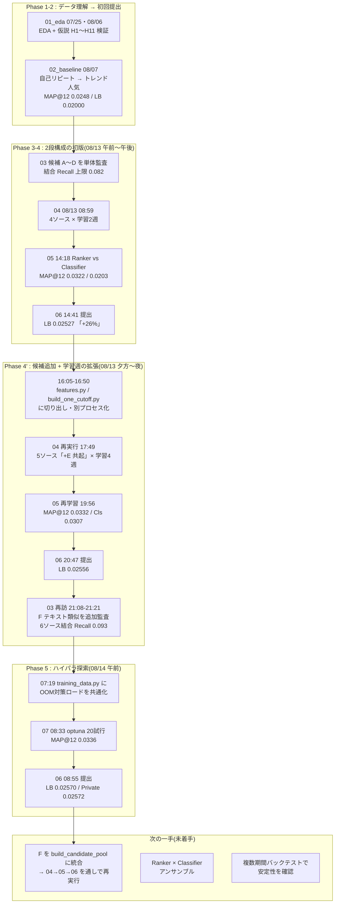
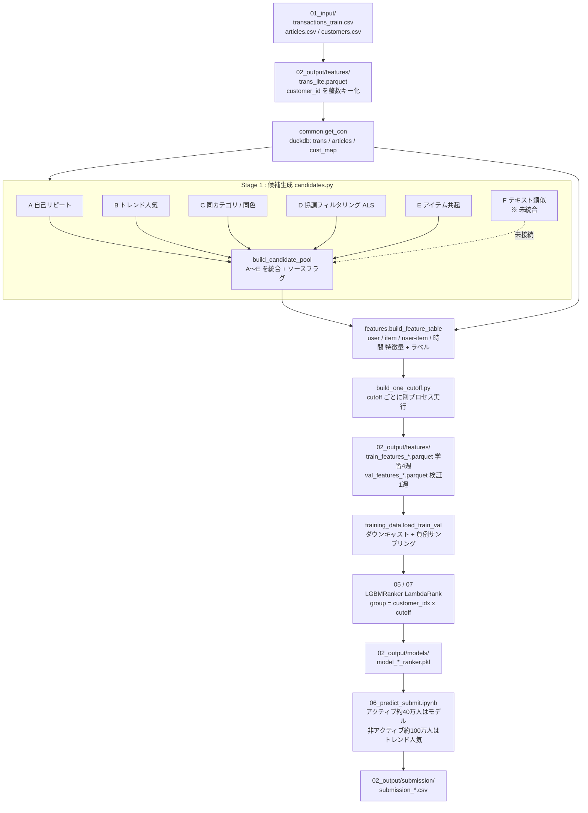

# パイプライン構築ログ / 最新版ステータス(2026-08-14 時点)

H&M Personalized Fashion Recommendations の実装記録。
`hypothesis_driven_design.md`(Phase 1〜2: EDA・仮説検証の詳細)と対になるドキュメントで、
候補生成 → モデル学習 → 提出までの実装内容・実施順・詰まったポイントをまとめている。

**新しいセッションでこの続きに着手する場合は、このファイルを最初に読むこと。**

---

## 0. 実施ロードマップ(何をどの順でやったか)

補足: 03 は「候補ソースの価値検証専用」のため、本番パイプラインの経路には入っていない。
新しい候補ソースを思いついたとき(E, F を追加したときのように)に戻ってきて再実行する位置づけ。

---

## 1. 本番パイプラインのデータフロー(現在の構成)

---

## 2. 結果推移(詳細は `experiment_log.csv`)

| 段階 | 説明 | バックテストMAP@12 | Public LB | Private LB |
|---|---|---|---|---|
| 02_baseline | 自己リピート+トレンド人気のルールベースハイブリッド | 0.0248 | 0.02000 | 0.02013 |
| 05(初回) | LGBMRanker、候補4ソース・学習2週 | 0.0322 | 0.02527 | 0.02505 |
| 05(共起+多週) | 候補5ソース(+アイテム共起)・学習4週 | 0.0332 | 0.02556 | 0.02574 |
| 07(optuna) | 上記+optuna20試行でのハイパラ探索 | 0.0336 | 0.02570 | 0.02572 |

baseline比で Public LB +28.5%。02_baselineとLGBMRankerとの間の伸びが最も大きく(+26%)、
そこから先(候補ソース追加・ハイパラ調整)は一段小さい伸び(各+1%前後)という収穫逓減の傾向。

---

## 3. ノートブック/モジュールの役割

- `01_eda.ipynb` — EDA、H1〜H11の仮説検証(詳細は `hypothesis_driven_design.md`)
- `02_baseline.ipynb` — 自己リピート(H1)+トレンド人気(H10)のルールベースハイブリッド。初回提出用
- `03_candidate_generation.ipynb` — 候補ソースA〜Fそれぞれの単体Recall@12/MAP@12を監査。
  **本番パイプラインには使わず、新しい候補ソースを追加する前の価値検証専用**
- `04_feature_engineering.ipynb` — 5つのcutoff(学習4週+検証1週)分の「候補×特徴量×ラベル」テーブルを作り、
  `train_features_*.parquet` / `val_features_*.parquet` に保存。
  cutoffごとに `build_one_cutoff.py` を**サブプロセスとして**呼ぶ(理由は6節のOOM対策参照)
- `05_train_lgbm.ipynb` — LGBMRanker(LambdaRank)とLGBMClassifier(binary)を学習・比較し、
  真の実購入集合に対するMAP@12で評価。モデルをpickle保存し実験ログに記録
- `06_predict_submit.ipynb` — 学習済みモデルで全顧客分の予測を作り、提出csvを生成
  (直近56日非アクティブな顧客はトレンド人気でフォールバック)
- `07_optuna_tune.ipynb` — LGBMRankerのハイパーパラメータをoptunaで探索し、
  ベストパラメータで本番モデルを再学習

共有モジュール(`Z_notebook/` 直下、`sys.path.append(os.path.abspath("."))` でnotebookから読み込む想定):

- `common.py` — duckdb接続(`get_con`、threads=4 / memory_limit=12GB)、バックテスト分割(`backtest_split`,
  `label_window`, `active_customers`)、評価指標(`apk`/`mapk`/`recall_at_k`/`mean_recall_at_k`)、
  提出フォーマット(`format_prediction`)、実験ログ追記(`append_experiment_log`)、
  共通パス定数(`DATA_DIR`/`FEATURES_DIR`/`TRANS_LITE_PATH`/`SUBMISSION_DIR`/`MODELS_DIR`/`EXPERIMENT_LOG_PATH`)
- `candidates.py` — 6候補ソースの生成ロジック。全関数 `target_customers` 引数で対象顧客に絞り込み可能
  (絞り込まないと大規模データでOOMする、6節参照)
  - A `build_repeat_candidates` — 自己リピート(H1)。直近購入日 → 頻度の順
  - B `build_popularity_candidates` — トレンド人気(H10、顧客非依存の全体トップN、直近7日窓)
  - C `build_category_color_candidates` — 同product_code色違い(H1)+最頻section_name人気(H2c)で穴埋め
  - D `build_cf_candidates` — implicit ALS(factors=50, iterations=12, alpha=40, `filter_already_liked_items=False`)
  - E `build_cooccurrence_candidates` — 同一顧客・同一日(バスケット、H8)の同時購入からitem-to-item共起。
    Aの上位12件をシードにする(`build_item_cooccurrence_table` で `cooc_top` を作ってから集計)
  - F `build_content_similarity_candidates` — 商品テキストのTF-IDF類似度(`build_content_similarity.py` が
    事前計算した `content_similarity.parquet` を使用、カタログのみに依存しcutoff非依存)。Aの上位12件をシードにする
  - `build_candidate_pool` — **現在A〜Eの5ソースを統合**(Fは未統合、8節参照)
- `features.py` — `build_feature_table(con, cutoff, ...)`: 候補プール + user系/item系/user-item交差系/
  時間系特徴量 + ラベルを1cutoff分作る(04・06から共通利用)。対象顧客は
  「cutoff以前56日以内に購入あり」∪「ラベル期間に購入あり」
- `training_data.py` — 05/07で使う学習データロード。OOM対策込み(6節)。`load_train_val()` で
  (train_df, val_df, feature_cols)を返す。`group_sizes()` でLightGBMの `group` 引数も作る
- `build_one_cutoff.py` — `build_feature_table` を1cutoff分だけ実行しparquet保存するCLI。
  `python build_one_cutoff.py --name train1 --cutoff 2020-09-08 --out <path>`
- `build_content_similarity.py` — articles.csvの `prod_name`/`product_type_name`/`colour_group_name`/
  `detail_desc` からTF-IDF(max_features=20000)+コサイン類似度(sklearn NearestNeighbors)で
  `content_similarity.parquet` を作るCLI。カタログのみに依存するため一度作れば使い回せる

### 学習/検証の週構成(04)

| 用途 | cutoff | ラベル期間 |
|---|---|---|
| 検証(val) | 最終日-7日 | val cutoff の翌日 〜 最終日 |
| 学習(train1) | 最終日-14日 | train1 cutoff の翌日 〜 val cutoff |
| 学習(train2) | 最終日-21日 | train2 cutoff の翌日 〜 train1 cutoff |
| 学習(train3) | 最終日-28日 | train3 cutoff の翌日 〜 train2 cutoff |
| 学習(train4) | 最終日-35日 | train4 cutoff の翌日 〜 train3 cutoff |

valは05/07でモデル評価専用に使い学習には混ぜない。全cutoffが2020年8〜9月に収まっており、
COVID期(2020年3〜4月)のレジームシフトは含まれない。

### 特徴量(30列、`experiment_log.csv` の `features` 列と一致)

- 候補ソースフラグ: `from_repeat` / `from_trend` / `from_category_color` / `from_cf` / `from_cooccurrence` / `n_sources`
- カテゴリ(category dtype): `product_group_name` / `index_group_name` / `section_name`
- user系: `u_total_purchases`, `u_distinct_articles`, `u_distinct_product_codes`, `u_avg_price`, `u_price_cv`,
  `u_days_since_last_purchase`, `u_online_ratio`, `u_active_weeks`, `u_menswear_share`,
  `u_babychildren_share`, `u_ladieswear_share`(H2a/H2b/H2c, H5, H7)
- item系: `i_total_sales`, `i_avg_price`, `i_days_since_last_sale`, `i_sales_7d`, `i_sales_28d`(H10)
- user-item交差系: `ui_times_bought`, `ui_days_since_last_bought`, `ui_times_bought_product_code`,
  `ui_days_since_last_bought_product_code`, `ui_price_diff`(H1, H5/H7)
- 時間系: `target_week_start_dom`(給料日効果、H11)
- `product_code` は生成はされるが学習では未使用(読み込み時点で除外)

---

## 4. 候補ソース別Recall@12/MAP@12(直近7日ホールドアウト、03の最終結果)

| ソース | Recall@12 | MAP@12 |
|---|---|---|
| A: 自己リピート | 0.0405 | 0.0238 |
| B: トレンド人気 | 0.0255 | 0.0087 |
| C: 同カテゴリ/同色 | 0.0211 | 0.0082 |
| D: 協調フィルタリング(ALS) | 0.0168 | 0.0065 |
| E: アイテム共起 | 0.0172 | 0.0063 |
| F: テキストコンテンツ類似 | 0.0098 | 0.0033 |
| 参考: 02_baselineハイブリッド(A→B) | 0.0457 | 0.0248 |
| **6ソース単純結合プール(上限72件)** | **0.0933** | — |

現行モデル(候補5ソース、Fは未統合)のMAP@12は0.0336で、5ソース結合時点のRecall上限(0.088)にはまだ届いていない
(=候補側よりモデル側にまだ伸びしろがある可能性)。

---

## 5. 現在の最良モデル(2026-09-18時点更新)

**Private LB基準の現在の最良モデルは `model_20260906_0924_ranker.pkl`(Private LB: 0.02620、
このコンペでの最高値)。`06_predict_submit.ipynb` のranker_pathもこれを指している。**
以下は2026-09-01時点の記述(当時のベスト)で、その後の経緯は本節末尾と「季節性特徴量の追加」節
(下記)を参照。

- モデル: `02_output/models/model_20260901_0953_ranker.pkl`(LGBMRanker, デフォルトパラメータ、
  `{"model":..., "feature_cols":..., "cat_cols":...}` の辞書)
- 学習データ: `02_output/features/train_features_20260831_2226.parquet`
  (候補6ソース[from_content_similarity含む]×学習4週) / `val_features_20260831_2226.parquet`
- バックテストMAP@12: 0.0338 / Public LB: 0.02624 / Private LB: 0.02618
- 最新提出ファイル: `02_output/submission/submission_20260901_1019_cv0.0338.csv`
- 詳細は `experiment_log.csv` の `run_20260901_0953_ranker` 行

**2026-09-06以降の更新**: `model_20260906_0924_ranker.pkl`(recency特徴量+候補k拡張、
backtest MAP@12=0.0345)がPublic LB=0.02621(0901よりわずかに低い)ながらPrivate LB=0.02620
(0901の0.02618を上回り、このコンペでの最高値)を記録し、現在の最良モデルとなっている。
2026-09-17〜18に季節性特徴量版を試したが、multi_week_eval.pyでの3週検証では改善を示したにも
かかわらずPrivate LBは0.02605に悪化したため不採用(詳細は本節末尾「季節性特徴量の追加」参照)。

### optunaは現時点では不採用

`07_optuna_tune.ipynb`(20試行、単一val週での探索)で得たパラメータは
backtest MAP@12こそ0.0344に改善したが、実際のLBはPublic 0.02571 / Private 0.02611と悪化した
(`run_20260901_1232_ranker_optuna`)。単一val週(直近7日)へのoptuna過適合と見られる。
再挑戦する場合は複数week分のvalで評価するなど、単一週依存を減らす工夫を検討すること。

### 候補ソースG(from_price_band)も不採用

顧客の平均価格帯±標準偏差(H5)に収まる直近人気商品を候補にする`build_price_band_popularity_candidates`
(`candidates.py`)を追加し7ソース化した。単体Recall@12=0.0217/MAP@12=0.0076でD/E/Fより良く、
パイプライン全体でもbacktest MAP@12は0.0338→0.0343に改善(`run_20260901_1508_ranker`)。
しかし実際のLBはPublic 0.02624→0.02585, Private 0.02618→0.02608と悪化し、
optunaの時と同様に単一val週には合うが実際の翌週テストには合わない傾向が見られた。
関数自体はcandidates.py/features.py/training_data.pyに残しているが、
`build_candidate_pool`からは呼ばない(6ソースに戻す)。

### recency特徴量+候補k拡張(2026-09-06)は明確な改善ではなかった

`u_purchases_7d`/`u_purchases_28d`/`u_purchases_91d`(直近7/28/91日の購入件数)を`features.py`に追加し、
`build_candidate_pool`の`k_per_source`を単体Recall@12が高かったA(自己リピート)・B(トレンド人気)のみ
12→20件に拡張(`candidates.py`の`DEFAULT_K_PER_SOURCE`)。backtest MAP@12は0.0338→0.0345に改善
(`run_20260906_0924_ranker`)したが、実際のLBはPublic 0.02624→0.02621(-0.00003)/
Private 0.02618→0.02620(+0.00002)とほぼ横ばいで、optunaや候補ソースGのような明確な悪化ではないものの
明確な改善でもなかった(ノイズ水準)。`06_predict_submit.ipynb`の`ranker_path`はこのrun
(`model_20260906_0924_ranker.pkl`)に更新済みだが、Public LBだけで見れば0901版がわずかに上であり、
「明確に上回った」とまでは言えない状態での更新である点に注意(次にモデルを差し替える際は、
この0906版とも比較すること)。

**ablationで両者の寄与を分離済み**(使い捨てスクリプトでrecency特徴量のみ・k=12のままの構成をbacktestのみ実行、
提出はしていない): baseline 0.0338 → recencyのみ追加で0.0340(+0.0002) → recency+k拡張(現行)で0.0345(+0.0007)。
打ち消し合ってはおらず両方とも同方向にわずかに寄与しているが、寄与のほとんど(+0.0005)はk拡張側。
どちらも単体では小さい効果で、これがLBでは横ばいに埋もれた可能性が高い。

### 複数週eval harnessでの再検証(2026-09-17)

単一val週(データ最終日の直近7日)だけを見る現状のbacktestが、optuna再チューニングや候補ソースG
(price_band)追加のような「backtestは改善するがLBは悪化する」ケースを一度も検出できなかった問題
(前述2節)を受け、`Z_notebook/multi_week_eval.py` を新規作成した。再学習はせず、既存の学習済み
モデルpickleを、どのモデルの学習にも使われていない過去3週
(`holdout_cutoffs`で機械的に選定: データ最終日-42/-49/-56日、2020-07-28〜08-11)に対して
候補生成→特徴量構築→スコアリングし、MAP@12のばらつきを見る仕組み。

結果(`model_20260901_0953_ranker`=デフォルトパラメータ6ソース、
`model_20260901_1232_ranker`=optuna探索版、`model_20260906_0924_ranker`=recency特徴量+k拡張版):

| cutoff | 0901_baseline | 0901_optuna | 0906_recency_k20 |
|---|---|---|---|
| 2020-08-11 | 0.02895 | 0.02913 | 0.02894 |
| 2020-08-04 | 0.02415 | 0.02407 | 0.02453 |
| 2020-07-28 | 0.02458 | 0.02458 | 0.02468 |
| **平均** | **0.02589** | **0.02592** | **0.02605** |

わかったこと:

- **optuna版は3週平均でbaselineとほぼ同値**(+0.00003、週によって勝ったり負けたりで一貫しない)。
  単一val週のbacktestが示した明確な改善(0.0338→0.0344)も、実LBが示した明確な悪化
  (0.02624→0.02571)も、この3週の多週評価では再現されなかった。つまり単一val週へのoptuna過適合
  という説明は「backtest側が単一週ノイズに引っ張られて過大な改善に見えた」という点では辻褄が合うが、
  「実LBがなぜそこまで悪化したか」は今回の3週(いずれも7〜8月、実際のLB対象週である9月末とは
  別の時期)だけでは説明しきれておらず、未解決のまま。
- **0906版(recency特徴量+k拡張)は3週中2週でbaselineを上回り、残り1週はほぼ同値**
  (平均+0.00016、方向は概ね一貫)。実LBの結果(Public -0.00003 / Private +0.00002、ほぼ横ばい)とも
  整合的で、「明確な改善ではないが明確な悪化でもない、ノイズ水準の微増」という位置づけが多週評価でも
  裏付けられた。06の`ranker_path`を0906版に据え置く判断は妥当と判断し、変更なし。
- 候補ソースG(price_band)は、追加時に7ソース用の候補プールがbuild_candidate_poolに正式統合されて
  おらず(アドホックなノートブックセルで組んだ形跡のみ)、現在のコードから同一構成を再現できなかった
  ため今回は多週再検証の対象外とした。実LBで既に明確な悪化(Public 0.02624→0.02585)が確認済みで
  優先度も低いため、再現性のある形で構成し直す作業は保留。
- 1週あたりの計算コストは約12分(候補生成のCF/ALSとcontent-similarityが支配的)。同じ候補ソース
  構成(k_per_source)を共有するモデル同士は候補+特徴量構築を1回で済ませ、予測だけ複数回行う
  (`group_score_at_cutoff`)ことで、3週×2グループ構成の総実行時間は約70分に収まった。

### 季節性特徴量の追加(2026-09-17〜18)

`features.py` に4つの季節性特徴量を追加した(target週の直前ではなく「target週のちょうど1年前の週」の
実績を見る点が7日/28日集計と異なる):

- `i_sales_yoy_7d`: article単位、target週の1年前に相当する週(cutoff-365〜cutoff-358)の売上件数
- `cat_sales_yoy_7d` / `cat_sales_recent_28d` / `cat_seasonal_lift`: section_name単位で同様の集計+
  「1年前の同週売上 ÷ 直近4週平均の週間売上」の比率。articleそのものは毎年入れ替わるため、
  より安定したsection_name単位でも同じ発想の特徴量を用意した

学習cutoffが8〜9月に偏っていても(月そのものを表す特徴量と違い)行ごとに値が変わるため学習可能、
という設計。6ソース×学習4週で04→05を再実行(`model_20260917_2337_ranker`)。

**単一val週(2020-09-15)のbacktestでは0906版(0.0345)よりわずかに悪化(0.0342, -0.0003)**。
feature importanceでは `i_sales_yoy_7d` が39特徴量中16位と一定の寄与を示したが、section_name単位の
3特徴量(`cat_sales_yoy_7d`/`cat_seasonal_lift`/`cat_sales_recent_28d`)は下位(22〜32位)。

ここで単一週の結果だけで不採用と判断せず、`multi_week_eval.py`で3つのheld-out週
(2020-07-28/08-04/08-11、0906版と同じ週)を使って再検証した:

| cutoff | 0906_baseline | 0917_seasonal |
|---|---|---|
| 2020-07-28 | 0.024675 | 0.024788 |
| 2020-08-04 | 0.024581 | 0.024712 |
| 2020-08-11 | 0.029037 | 0.029117 |
| **平均** | **0.026098** | **0.026206** |

**3週すべてで季節性特徴量版が一貫してbaselineを上回った**(平均+0.0001、約+0.4%)。
単一val週では悪化して見えたのに、その週の学習に使われていない他の3週では逆に一貫して改善しており、
「単一週の結果だけでは判断しない」という今日確立した方針がまさに効いたケース。単一週だけを見ていたら
季節性特徴量を誤って不採用にしていた可能性が高い。効果量は小さいが方向は一貫しているため、
次の提出候補として有力と判断し、実際にKaggleへ提出した。

**しかし実際の結果は失敗だった**: Public LB=0.02623(0906版0.02621よりわずかに改善)だったが、
**Private LB=0.02605と0906版(0.02620、これまでの最高値)より明確に悪化**(-0.00015)した。
3週すべてのmulti_week_eval結果が一貫して改善を示していたにもかかわらず、Private LBの悪化は
検出できなかった。3週とも2020年7〜8月に集中しており季節・期間の分散が狭かったことが一因と見られる
(=「複数週」ではあっても「複数季節」ではなかった)。`06_predict_submit.ipynb`のranker_pathは
0906版(model_20260906_0924_ranker)に復帰済み。詳細は`experiment_log.csv`の
`run_20260917_2337_ranker`行、`08_multi_week_backtest.ipynb`参照。

**教訓**: 3週程度のheld-out検証で一貫した改善が見えても、Private LB相当の悪化を必ず検出できるとは
限らない。次に何かを再検証する際は、held-out週を季節的によりバラけさせる(例: 2019年の異なる月)、
またはPublicより大きいサンプルでの検証方法を検討すること(8節の「複数期間バックテスト」課題は
依然として未解決)。

実装上の副産物: この学習でtrain_features(6ソース×学習4週、約116M行)読み込み時に一度OOM killされた
(pandas側でdowncastする前の生dtype[int64/float64]のまま全列を一旦メモリに展開するのが原因、列数が
増えるほどこのピークが線形に増える)。`training_data.py`の`_load_one`を、pandasに変換する**前**に
Arrow Tableの段階でint8/int32/float32へcastするよう修正し(`_ARROW_DOWNCAST`)、再実行で解消した。

### 06のモデル選択について(重要)

以前は `06_predict_submit.ipynb` の `ranker_path = sorted(glob.glob(...))[-1]` で
最新モデルファイルを自動選択していたが、上記のoptuna過適合の件で
「最新 = 最良」が成り立たないことが判明したため、**`ranker_path` は現在ベストモデルへの
固定パス(ハードコード)に変更済み**(`06_predict_submit.ipynb` 内にコメントで理由を明記)。
新しいrunが `experiment_log.csv` 上でこのベストを明確に上回ったことを確認してから、
手動で `ranker_path` と `BACKTEST_MAP12` を更新すること(2026-09-06時点、上記のとおりこの基準を
厳密には満たさないまま0906版に更新している)。

---

## 6. ハマったポイントと対策(重要、再度踏まないように)

このマシンは実メモリ16GBで、80M行規模のデータを扱うと素朴な実装ではほぼ確実にOOMする。
jetsamログ(`/Library/Logs/DiagnosticReports/JetsamEvent-*.ips`)で `Python` プロセスのkillを複数回確認した。

1. **train_features parquet(80M行)を `pd.read_parquet` で素朴に読むと即OOM**。
   文字列カテゴリ列がpandasの `object` dtype(行ごとにPythonの文字列オブジェクト)として展開され、
   読み込み時点だけでメモリを使い切る。
   → `pyarrow.parquet.read_table(..., columns=...).to_pandas(categories=[...])` で
   dictionary encodingのまま `category` dtypeにする。`training_data.py` に集約済み。
2. **train/valを両方読み込んでからダウンキャストすると、2つの巨大な生DataFrameが同時に存在する瞬間ができてOOM**
   (実測でメモリ使用量が約30GBに到達)。
   → trainを読み込み→ダウンキャスト→負例サンプリングまで完全に終わらせてから、valの生DataFrameを読み込む
   (`training_data.load_train_val` の実装順序そのもの)。
3. **candidates.pyのA/Cソースが元々target_customersで絞り込んでおらず、毎回全顧客(最大約137万人)分を
   計算していた**。これも大規模データでのOOMの一因(かつ単純に無駄な計算)。
   → `build_repeat_candidates`/`build_category_color_candidates` に `target_customers` 引数を追加し、
   `_register_target_customers` でduckdbに一時テーブル登録してWHERE句で絞り込む。
   `build_candidate_pool` はこれを渡すよう修正済み。**03のような「あえて全顧客で見たい」場面以外は
   必ずtarget_customersを渡すこと**(03でも `actual_map.keys()` を渡すよう修正済み)。
4. **04で5週分を1つのJupyterカーネルに溜め込むとOOM killされる**。
   → `build_one_cutoff.py` でcutoffごとに独立したOSプロセスとして実行し、
   各cutoff処理後にOSへメモリを完全に返却させる(04ノートブックは `subprocess.run` でこれを呼ぶ)。
5. **duckdbの `PRAGMA memory_limit` は低く設定しすぎると正常なクエリまで失敗する**。
   8GBに設定した状態で同カテゴリ/同色クエリが `OutOfMemoryException` になった実例あり。
   現在 `common.py` で12GBに設定している。サブプロセス(build_one_cutoff.py)は
   1プロセス=16GB丸ごと使えるので問題ないが、03/06のように単一プロセスで完結させるノートブックは
   この値の影響を受ける。
6. **陽性率が0.08%程度と極端に不均衡**なため、80M行のうち正解を1件も含まないグループ(顧客×cutoff)が
   96.8%を占める。これをグループ単位で15%だけ残す負例サンプリングでサイズを約14Mまで落としている
   (`training_data.py` の `neg_group_sample_frac` パラメータ)。**行単位で間引くとLightGBMの `group` 引数と
   対応が崩れるので、必ずグループ(顧客×cutoff)単位で残す/落とすを決めること**。
7. pyarrowで別々のparquetファイルを `categories=` 指定で読むと、ファイルごとに辞書順(category codes)が
   独立に決まる。06での予測時は学習時と同じcategoriesを使う必要があるため、
   train_features parquetから同じ手順でcategoriesを再現している(06のセル参照)。
8. `Z_notebook/.tmp/` にduckdbのディスクスピル用一時ファイルが溜まる(実行を重ねると数GB規模)。
   実行完了後に安全に削除できる(次回実行時に再作成される)。
9. **04の「学習4週を結合」セルが素朴な `pd.read_parquet` + `pd.concat` だと、行数が増えた際にOOM killされる**
   (2026-09-06、recency特徴量追加+候補k拡張で行数が96M→116Mに増えた際に実際に発生・再現確認済み。
   単体ファイルのread自体はRSS数GBで収まるが、生dtype[objectの文字列列等]のまま4ファイル分を`pd.concat`
   する瞬間に爆発しSIGKILLされる)。→ `training_data.py` の `_load_one`(pyarrow categories + int8/int32/
   float32ダウンキャスト)を04でも使うよう修正し、1ファイルずつ軽量化してからconcatするように変更済み
   (`04_feature_engineering.ipynb` のセル参照)。**素朴な複数parquetの読み込み+concatは、行数が増えるたびに
   再発しうるので注意。**

---

## 7. コードとドキュメントの不整合(2026-08-14 のコード確認で検出、未修正)

いずれも結果には影響しないが、次に触るときに直しておくと迷いが減る。

1. `07_optuna_tune.ipynb` の実験ログ書き込みで `notes` が **「valは6候補ソース結合プール由来」** と
   ハードコードされているが、実際の `build_candidate_pool` は5ソース。
   `experiment_log.csv` の `run_20260814_0833_ranker_optuna` 行にもそのまま入っている(`features` 列の
   `from_*` フラグが5個であることが正)。
2. `05_train_lgbm.ipynb` は `training_data.py` を切り出す**前**に書かれたため、
   読み込み・ダウンキャスト・負例サンプリングのロジックをノートブック内に重複して持っている
   (07は `training_data.load_train_val` を使用)。05も差し替えれば単一実装になる。
3. `candidates.py` のモジュール冒頭docstringが
   「自己リピート/トレンド人気/同カテゴリ同色/協調フィルタリング」の4ソースのままで、E・Fが未記載。
4. `common.py` のdocstringに「候補生成・特徴量エンジニアリングそのもののロジックはここに置かず、
   各ノートブックに書く」とあるが、実際は `candidates.py` / `features.py` に切り出し済み。
5. `README.md` が 06/07 と `candidates.py`/`features.py`/`training_data.py` の追加を反映していない
   (`CLAUDE.md` 側は最新)。

---

## 8. 未着手・今後の選択肢

- **ソースF(テキストコンテンツ類似)は `build_candidate_pool` に未統合**。単体では全ソース中最弱だが、
  6ソース結合時のRecall上限は5ソース時点の0.088から0.093まで伸びた(+5.7%)。統合する場合は
  `candidates.py` の `build_candidate_pool` に `from_content_similarity` フラグを追加し、
  `features.py` のSELECT文(および `training_data.py` の `INT8_COLS`)にも追加した上で、
  04→05→06を通しで再実行する必要がある
  (04だけで候補5ソースの場合実測約45分、05の学習も含めると通しで1時間強)
- 画像embeddingは未着手。テキスト類似度(F)が最弱だったこと、105,100枚の高解像度画像への
  CNN推論はこのマシンだと相当重くなることから優先度を下げている
- 複数期間(季節性の異なる時期)でのバックテスト安定性は未検証。今回の学習/検証cutoffは
  全て2020年8月〜9月に集中しており、COVID期(2020年3〜4月)や他の季節は含まれていない
- CF(implicit ALS)は一貫して単体最弱グループ。`alpha`/`factors`/`iterations` のチューニングは未実施
- Classifierは負例サンプリング後のデータでMAP@12=0.0307までRankerに肉薄した(前回0.0203から大幅改善)。
  **2026-09-06に0906モデル(ranker/classifier)でアンサンブルを試したが効果なし**: 顧客ごとにスコアを
  min-maxで[0,1]正規化してから加重平均したところ、backtest MAP@12はranker単体0.03448が最良で、
  classifierの重みを上げるほど単調に悪化した(w_ranker=0.75→0.03420, 0.5→0.03366, 0.25→0.03269,
  0(classifier単体)→0.03057)。この正規化方式・重み刻みでは不採用。試す場合はrank平均など
  別の正規化方式を検討すること。
- 05/07ともに **valでearly stoppingを掛けたうえで同じvalでMAP@12を測っている**ため、
  報告値は完全に独立した評価ではない(LBとの乖離幅を見るときはこの点に留意)

---

## 9. 環境・運用メモ

- Python: `/Users/woojoohyeon/Desktop/01_coding/.venv/bin/python3`(`.venv` は `01_coding` 直下、
  Kaggle全体で共有)
- このセッションで追加インストール: `implicit`(協調フィルタリング用)。`Kaggle/requirements.txt` に追記済み
- ノートブック実行は `jupyter nbconvert --to notebook --execute --inplace <name>.ipynb` で行っている
  (結果はセル出力にそのまま残る形。重い処理はバックグラウンド実行+完了待ちのパターンを多用した)
- Kaggle提出: `kaggle competitions submit -c h-and-m-personalized-fashion-recommendations -f <csv> -m "<message>"`、
  スコア確認: `kaggle competitions submissions -c h-and-m-personalized-fashion-recommendations`

## 10. Git状態(2026-08-14 時点)

直近のコミットは `762c2a8 Add hypothesis-driven EDA (H1-H11) and project CLAUDE.md` まで。
以下は**まだ未コミット**:

- 変更: `CLAUDE.md`, `README.md`, `experiment_log.csv`
- 新規: `00_md/pipeline_build_log.md`, `Z_notebook/02〜07_*.ipynb`,
  `Z_notebook/{common,candidates,features,training_data,build_one_cutoff,build_content_similarity}.py`,
  `Z_notebook/00_md/`

コミットするかはユーザーの指示を待つこと。コミット前は `CLAUDE.md` のルール通り
Notebookのセル出力をクリアすることを忘れずに。
