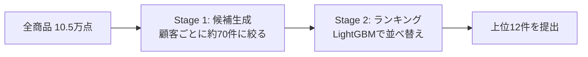

# H&M Personalized Fashion Recommendations — 最終発表資料

対象コンペ: Kaggle「H&M Personalized Fashion Recommendations」(Featured Prediction Competition, 主催: H&M Group)
本資料の位置づけ: 前回の進捗発表以降の変更点を含めた、最終報告用のまとめ

---

## 0. 3行サマリー

1. 「過去の購買履歴から、各顧客が来週買う商品を12個当てる」課題に対して、**候補生成→ランキングの2段構成**で取り組んだ。
2. 途中、手元では改善したのにLBで悪化する失敗が3回続いた。原因は**検証方法**そのものにあった。
3. 検証方法を作り直し、「季節性より直近の流行が効く」という**短期トレンド仮説**に切り替えた結果、**Private LB 0.02681(過去最高)**に到達した。

---

## 1. 課題設定

| 項目 | 内容 |
|---|---|
| データ期間 | 2018-09-20 〜 2020-09-22(取引3,179万件、顧客137万人、商品10.5万点) |
| 予測対象 | データ最終日の翌週(2020-09-23〜29)に、各顧客が買う商品を12個予測 |
| 評価指標 | MAP@12(Mean Average Precision at 12)。上位に正解を集中させるほど高評価。上位陣でも0.03〜0.04程度と、当てにくい課題 |
| 参加規模 | 約2,900〜3,000チーム |
| 現在の状況 | コンペ終了後、Late Submission(締切後採点)で継続して取り組み中 |

---

## 2. なぜこの手法構成にしたか

### 2.1 候補生成 → ランキングの2段構成

**理由1: 全組み合わせは計算不可能**
顧客137万人×商品10.5万点 ≈ 1,400億通り。まず安い方法で「買いそうなもの」を数十件に絞り(候補生成、Recall重視)、その中だけを賢いモデルで並べ替える(ランキング、Precision重視)。上位解法もほぼ全員この構成。

**理由2: 手がかりの種類がバラバラ**
EDAで「同じ商品・色違いの買い直し」「直近の流行品」「男性服・子供服購入者の系統的な買い方」「一緒に買われる商品」など、性質の異なる購買パターンが複数見つかったため、候補生成では複数ソースを並行して使う設計にした。

**理由3: ランキングにLightGBMのLambdaRankを採用**
- 「買う/買わない」の二値分類ではなく、**顧客ごとの並び順そのものを最適化**する学習方法
- MAP@12は並び順を評価する指標なので、目的と学習方法が一致する
- 実際にClassifier(二値分類+確率ソート)よりRanker(LambdaRank)が一貫して良かった
- ニューラルネット・画像特徴は、計算コストに見合うだけの伸びが見込めないと判断して見送り(画像特徴は未着手)

---

## 3. 仮説の変遷 — なぜ「短期トレンド仮説」にたどり着いたか

最初から「季節性より直近トレンドが効く」と考えていたわけではなく、**3回の失敗を検証で掘り下げた結果として導いた仮説**である。この経緯自体が、今回の取り組みで最も重要なポイントの一つ。

### 3.1 まず仮説を数字で確かめる(07-25〜08-06)

EDAで購買行動仮説H1〜H11を集計で検証。
- 同一商品の再購入14%+色違い9% = リピート系が合計23% → 自己リピート候補は有効だが、それだけでは不足
- 男性服・子供服は一度買った人が買い続ける(母集団の4.8倍・9.6倍)
- 週次売上に大きなスパイクとCOVID期の落ち込み → 流行性の強さを示唆

### 3.2 ルールベース→2段構成で最大の伸び(08-07〜08-13)

| 内容 | Public | Private |
|---|---|---|
| ルールベース(自己リピート+人気で補完) | 0.02000 | 0.02013 |
| 2段構成(候補生成+LightGBM Ranker) | 0.02527 | 0.02505 |

+26%という、今回のプロジェクトで最大のジャンプ。

### 3.3 「手元では良いのにLBで悪化」— 最初の壁(08-14〜09-18)

| 試したこと | 手元 | LB(Private) | 結果 |
|---|---|---|---|
| Optuna(ハイパーパラメータ自動探索) | 改善 | 横ばい〜悪化 | 不採用 |
| 候補G(価格帯フィルタ人気) | 改善 | 悪化 | 不採用 |
| 季節性特徴量(YoY、前年同週の売上) | 3週で一貫して改善 | 0.02620→0.02605に悪化 | 不採用 |

3回とも「手元の検証が甘く、ノイズや偏りを改善と見誤った」ことが共通原因。

### 3.4 失敗の原因を検証方法自体に遡って調べる(09-17〜09-21)

- **1週だけで測っていた**: MAP@12は週ごとのブレが大きい
- **early stoppingに使った週で、そのまま成績を報告していた**: 答えを少し見た状態での採点 → 楽観的な成績
- **複数週で測っても同じ季節だった**: 季節性特徴(YoY)は検証3週(2020年7〜8月)で勝っていたが、季節を分散させた8週(秋・初冬・年末商戦・閑散期・初夏・夏)で同じモデルを再採点すると、**7〜8月でしか効いておらず、8週平均ではほぼ差ゼロ**と判明
- 公開されている上位解法(銀メダル解法2本など)も調べたところ、季節性を明示的に使っているチームは見当たらず、みな直近1〜6週の情報だけで組んでいた

→ **「季節性という反証可能な仮説を、検証を通じて自ら潰した結果として残った方向」が短期トレンド仮説**である。思いつきではなく、消去法的に導かれた転換だったという点が説明上のポイント。

### 3.5 短期トレンド仮説への切り替え(09-21)

**新しい仮説**: ファストファッションでは、季節性(前年同週の売れ方)よりも、直近数日〜数週間の流行の勢い・新しさ・同年代での流行が購買を決める。

---

## 4. 短期トレンド仮説の実装

既存の04/05/06ノートブックの挙動は変えず(0906版はそのまま再現可能)、新しい列・候補ソースは明示的に有効化したときだけ作られる設計にした。

### 4.1 短期トレンド特徴量(TREND_FEATURES、18列)

| カテゴリ | 特徴量 |
|---|---|
| 商品の勢い | 1/3/14日販売数(`i_sales_1d/3d/14d`)、前週販売数(`i_sales_prev7d`)、前週比(`i_wow_ratio`)、指数減衰スコア(`i_sales_decay`)、7日購入者数(`i_buyers_7d`)、7日順位(`i_rank_7d`) |
| 新しさ・値下げ | 発売からの日数(`i_days_since_first_sale`)、直近7日の平均価格/通常価格比(`i_price_ratio_7d`) |
| 同年齢層での流行 | 年齢(`u_age`)、同年齢層7日販売数・シェア・順位(`ia_sales_7d`, `ia_share_7d`, `ia_rank_7d`) |
| 売場(section)単位 | 7日販売数(`sec_sales_7d`)、前週比(`sec_wow_ratio`) |
| ユーザーの新作志向 | 直近91日の購入時点での平均商品齢(`u_item_age_at_purchase_avg`)、発売14日以内商品の購入比率(`u_new_item_share`) |

特徴量重要度(gain)では、トレンド系の合計シェアが約37%。上位に`ia_share_7d`(全体2位)、`i_sales_3d`、`i_sales_decay`、`i_sales_1d`、`i_days_since_first_sale`が入り、「直近1〜3日」が「直近7日」と同等以上に効いている点が仮説と整合していた。

### 4.2 年齢層別トレンド候補(候補ソースH、`from_age_trend`)

`AGE_BUCKET_EDGES = [20, 25, 30, 40, 50, 60]` により、年齢を以下8層に区分:

| バケット | 範囲 |
|---|---|
| -1 | 年齢不明 |
| 0 | 20歳未満 |
| 1 | 20-24歳 |
| 2 | 25-29歳 |
| 3 | 30-39歳 |
| 4 | 40-49歳 |
| 5 | 50-59歳 |
| 6 | 60歳以上 |

20代のみ5歳刻みで細分化し、30代以降は10歳刻み(20代前半・後半で購買パターンの差が大きいという想定)。cutoff直前7日間で、同じ年齢層の顧客に最も売れた上位12件を候補に追加。全体トレンド(B)は全員に同じ20件を出すが、こちらは年齢層ごとに異なるリストになる。

### 4.3 コールドスタート(直近購入履歴のない顧客、全体の約2/3)の推薦変更

「全体で売れている12件」→「同じ年齢層で直近7日に売れている12件」(`+agecold`)。これはトレンド特徴量とは独立した変更で、単体でも効果があった。

---

## 5. 候補生成の内訳(実測値で確定)

### 5.1 全7ソースの上限件数

`candidates.py`の`DEFAULT_K_PER_SOURCE`より:

| ソース | 記号 | 上限件数 | 仕組み |
|---|---|---|---|
| A 自己リピート | `from_repeat` | 20 | 直近購入日→頻度順 |
| B 全体トレンド人気 | `from_trend` | 20 | cutoff直前7日間の全体売上ランキング(COUNT(*)、全顧客共通) |
| C 同カテゴリ/同色 | `from_category_color` | 12 | product_code色違い優先、不足分は最頻section名の人気商品で補完 |
| D 協調フィルタリング(ALS) | `from_cf` | 12 | 購買回数行列の潜在因子分解(後述) |
| E アイテム共起 | `from_cooccurrence` | 12 | 自己リピート上位12件をシードに、同日同顧客で一緒に買われた商品を集計 |
| F テキスト類似(TF-IDF) | `from_content_similarity` | 12 | 商品説明文のコサイン類似度(後述) |
| **base小計** | | **88** | 6ソース単純合計 |
| H 年齢層別トレンド(追加時のみ) | `from_age_trend` | 12 | 同年齢層内での直近7日人気(4.2節) |
| **重複除去前の最大** | | **100** | base 88 + H 12 |

「A・Bだけ20件」なのは、03番ノートブックでソース単独のRecall@12を検証した結果、自己リピートとトレンド人気が特にRecall寄与が高かったため、その2つだけ12→20に拡張したという経緯による。

候補プールは`(customer_idx, article_id)`単位でGROUP BYして重複除去される(同じ商品が複数ソースから来た場合は1件に統合され、どのソース由来かは`from_*`フラグ列に残る)。**「複数の基準を全部満たさないと候補に入らない」のではなく「1つの基準を満たすだけで候補プールに入る」OR(和集合)構造**である。

### 5.2 実測値(trend_full構成、holdoutログより)

| 週 | 対象顧客数 | 候補ペア数 | 1人あたり平均 |
|---|---|---|---|
| holdout1 (08-11) | 451,668 | 33,446,037 | 74.1件 |
| holdout2 (08-04) | 454,706 | 32,934,005 | 72.4件 |
| holdout3 (07-28) | 455,731 | 32,570,757 | 71.5件 |
| **平均** | | | **約72件** |

重複除去前の最大100件のうち、実測では約72件しか残らない=**重複で約3割が消えている**。これは自然な現象で、「よく買う商品」が自己リピートにもトレンド人気にも同時に入る、といったことが頻繁に起きるため。むしろこの重なり自体が情報であり、`n_sources`(いくつのソースから推薦されたか)という特徴量としてそのままモデルに使われている。

(base構成=年齢層トレンドなしの平均はログから直接は読めず、必要であれば特徴量parquetに対し`n_sources > 0`件数を顧客数で割るクエリで算出可能)

### 5.3 各手法の仕組み(補足)

**ALS(協調フィルタリング)**
- 実際のハイパーパラメータ: `factors=50, iterations=12, alpha=40.0, regularization=0.01`
- 顧客×商品の購買回数行列を、`confidence = 1 + alpha × 購買回数`という信頼度に変換した上でimplicit ALSで50次元の潜在ベクトルに分解(Hu-Koren-Volinskyのimplicit feedback ALS定式)
- 似た購買傾向の顧客は似たベクトルになり、顧客ベクトル×商品ベクトルの内積が高い商品を推薦する仕組み
- `filter_already_liked_items=False`のため、既に購入済みの商品も再度候補に出ることがある(自己リピート候補Aと重なりうる)

**TF-IDF(テキスト類似)**
- `prod_name + product_type_name + colour_group_name + detail_desc`を連結した文字列を、`TfidfVectorizer(max_features=20000, stop_words="english")`でベクトル化
- `NearestNeighbors(metric="cosine", algorithm="brute")`で全商品ペアを総当たり計算し、コサイン類似度上位20件を保存
- **意味理解ではなく、単語出現パターンの統計的な近さ**を見ている(例: "black jacket"と"dark coat"のような同義語は拾えない)
- カタログ情報のみに依存し取引データを見ないため、cutoffに関係なく1回計算すれば使い回せる(CF・共起はcutoffごとの再計算が必要なのと対照的)

---

## 6. 季節性特徴量(YoY)の詳細検証

### 6.1 何を計算していたか

`i_sales_yoy_7d`: 予測対象週(cutoff, cutoff+7]の**ちょうど1年前にあたる週**の商品別販売数
`cat_seasonal_lift`: 1年前同週のカテゴリ販売数 ÷ (直近28日の週平均販売数) — 「昨年のこの時期、直近トレンドと比べて何倍売れていたか」という相対的な季節倍率

いずれも`cutoff`を関数引数として受け取り、**採点する週が変われば「1年前」も自動的に追従する**設計。つまり特徴量の値自体は各季節に対して正しく計算されている。

### 6.2 なぜそれでも効果が消えたか

モデルの重みは学習時点(2020年8〜9月近辺、夏〜秋)で一度だけ固定される。3世代検証で行ったのは、この**固定された重み**のモデルに、8つの異なる時期に対して**正しく再計算したYoY入力値**を与えて採点する、という手順だった(再学習はしていない)。

結果、モデルが学習した「YoYが高い→購入されやすい」という関係自体が、**夏季データに特有のパターンであり、他の季節では成立しなかった**(YoYが高くても実際には売れない)ことが判明。これが「季節性特徴は特定の季節にしか効かない」という結論の正確な意味である。

---

## 7. 検証方法の変遷(4世代)

モデル側の改善と並行して、「手元の検証がどれだけLBの良し悪しを事前に見抜けるか」という検証方法自体も4段階で作り直した。**今回の成果は、実質的にはこちらの試行錯誤の成果でもある。**

| 世代 | やり方 | 見抜けたこと | 見抜けなかったこと |
|---|---|---|---|
| 1(08-13〜09-06) | 直近1週のみ、early stoppingも同じ週 | — | Optuna・候補Gの悪化 |
| 2(09-17) | 過去3週(同じ季節、2020年7〜8月)で再採点、再学習なし | Optunaの改善はノイズ | 季節性特徴の悪化 |
| 3(09-21, Colab) | 季節をバラした8週(秋・初冬・年末商戦・閑散期・初夏・夏)で0906版/0917版を再採点 | 季節性特徴は特定季節のみ有効 | 後から採点する方式で新しい実験に使いにくい |
| 4(09-21、現行) | 学習/early stopping判定/報告の役割分離+提出と同じ採点方式+ブートストラップ | 短期トレンドの効果(LBでも確認) | 季節偏りは任意の追加週で別途確認 |

### 7.1 現行(第4世代)プロトコルの具体的な設計

| 役割 | 使う週 |
|---|---|
| 学習 | 3週(train2〜4) |
| early stopping判定のみ | 1週(train1) |
| 成績報告のみ(学習・判定に一切使わない) | val + 過去3週(holdout1〜3、任意でseason1〜3も追加可) |

- **提出と同じ作り方で採点**: 実際の提出と同様、直近56日にアクティブな顧客だけモデル上位12件、それ以外はフォールバックで採点(従来は評価週の非アクティブ顧客もモデルで採点しており、その分楽観的だった)
- **フォールバックは2通り**: 全体人気、および同年齢層の直近人気(`+agecold`)
- **顧客単位のペアブートストラップで95%信頼区間を算出**。採用条件は「pooled CIの下限 > 0」かつ「4分の3以上の週で改善」
- **1つの特徴量テーブルから3条件(base / trend_feat / trend_full)を作り分ける**ことで、ablation比較を公平にする
- 実物の0906モデルも同じ方法・同じ週で採点し、学習し直したbaseモデルとほぼ一致することを確認(比較の土台が正しいことのサニティチェック)

### 7.2 副産物として見つけたバグ

- **Colab(51GB)でのOOM**: 候補プールをPythonの辞書の辞書で統合していたのが原因(1ペア約520バイト、3,100万ペアで約16GB)。縦持ち配列+duckdbのGROUP BYに変更し約130バイト/ペアに削減。2020-07-28(3,257万ペア)が7.0分で完走するようになった
- **ALSの結果が実行ごとに揺れる問題**: duckdbのGROUP BY行順が毎回変わり、商品インデックスの採番も変わっていたのが原因。商品IDをソートしてから採番するよう修正し、完全な再現性を確保

---

## 8. なぜ学習期間自体を複数季節にしなかったか

説明会で出やすい質問への回答を整理。

1. **仮説そのものと矛盾するため**: 「予測しようとしているその時点に近い直近の流れ」を学ばせたいのに、学習データに複数季節を混ぜると「季節をまたいだ平均的なパターン」を学んでしまい、狙いと逆行する
2. **データが2年分しかなく、古い区間には別の問題が混ざる**: 2020年3〜4月(COVID初期)は購買パターンが完全に異例で、検証でも意図的に除外した。2018年末のような古い区間はカタログ構成・オンライン比率自体が現在と異なる可能性があり、「その時は成り立ったが今は成り立たない」パターンを学習に持ち込むリスクがある
3. **検証と学習の役割分離**: 「季節に関係なく一般的に通用するか」を確認するのは検証(第3世代の8週分散テスト)の役割であり、学習の役割ではない。両方を同じデータで混ぜると、モデルの良し悪しと検証の公正さを同時に揺らがせ、原因の切り分けが難しくなる

一言でまとめると: 「学習は実戦と最も近い条件を学ばせるためのもの、検証はそのモデルが他の条件でも崩れないかを確認するためのもの。目的が違うので、学習は直近の時期に集中させ、季節の多様性は別の検証段階で確認した。」

なお、学習に使う週数自体(現在3週)を増やす方向の感度実験は次の改善候補に入っているが、これは「季節を混ぜる」のではなく「同じ直近の時期の中で学習データ量を増やす」実験であり、方向性が異なる。

---

## 9. オフライン評価結果

MAP@12は提出と同じ作り方で計算(旧backtestの0.0345より低いのは、楽観バイアスが抜けて正確になったため。LB水準(0.0262)に近づいた)。

| 週 | base | ref_0906 | trend_feat | trend_full | base+agecold | ref_0906+agecold | trend_feat+agecold | trend_full+agecold |
|---|---|---|---|---|---|---|---|---|
| val (09-15) | 0.03132 | 0.03168 | 0.03220 | 0.03206 | 0.03173 | 0.03209 | 0.03261 | 0.03247 |
| holdout1 (08-11) | 0.02663 | 0.02653 | 0.02707 | 0.02734 | 0.02743 | 0.02734 | 0.02788 | 0.02815 |
| holdout2 (08-04) | 0.02230 | 0.02247 | 0.02266 | 0.02292 | 0.02297 | 0.02314 | 0.02333 | 0.02359 |
| holdout3 (07-28) | 0.02219 | 0.02220 | 0.02245 | 0.02241 | 0.02254 | 0.02255 | 0.02280 | 0.02276 |
| 平均 | 0.02561 | 0.02572 | 0.02610 | 0.02618 | 0.02617 | 0.02628 | 0.02666 | 0.02674 |

baseとの差(pooledブートストラップ、改善週数):

| 変更 | 改善幅(95%CI) | 改善した週 |
|---|---|---|
| ref_0906 | +0.00011 [-0.00000, +0.00022] | 3/4週 |
| base+agecold | +0.00055 [0.00046, 0.00064] | 4/4週 |
| trend_feat | +0.00047 [0.00035, 0.00060] | 4/4週 |
| trend_full | +0.00056 [0.00043, 0.00069] | 4/4週 |
| trend_feat+agecold | +0.00103 [0.00088, 0.00118] | 4/4週 |
| **trend_full+agecold** | **+0.00111 [0.00095, 0.00127]** | **4/4週** |

トレンド特徴量とコールドスタート変更は、それぞれ独立に効いており、ほぼ足し算になっている。年齢層別トレンド候補(H)自体の追加効果はtrend_featとの差が小さく(2/4週しか勝っておらずノイズと区別できない水準)、主効果はトレンド特徴量とコールドスタート変更にある。

---

## 10. スコア推移とLB結果

| 日付 | 内容 | Public | Private |
|---|---|---|---|
| 08-07 | ルールベース | 0.02000 | 0.02013 |
| 08-13 | 2段構成(LightGBM Ranker) | 0.02527 | 0.02505 |
| 08-13 | +アイテム共起・学習4週 | 0.02556 | 0.02574 |
| 08-14 | Optuna | 0.02570 | 0.02572 |
| 09-01 | +テキスト類似(6ソース) | 0.02624 | 0.02618 |
| 09-01 | +候補G(価格帯) | 0.02585 | 0.02608 |
| 09-06 | recency特徴量+候補数拡張(0906版) | 0.02621 | 0.02620 |
| 09-18 | +季節性特徴量(0917版) | 0.02623 | 0.02605 |
| **09-21** | **短期トレンド+年齢層候補+年齢層フォールバック** | **0.02685** | **0.02681** |

- Private +0.00061(+2.3%)、Publicは+0.00064。**PublicとPrivate両方が同じ向きに改善**(0917版はPublicだけ上がりPrivateが下がっており、ノイズに乗った典型例)
- オフラインで予測した改善幅(+0.00111)の約6割がLBでも再現された

---

## 11. オフライン・Public・Private の関係

| スコア | 何か | 役割 |
|---|---|---|
| オフライン | 過去週を「未来」に見立てて自己採点 | 日々の判断に使う唯一の指標 |
| Public LB | テスト週の一部顧客で採点、提出直後に見える | 途中経過。合わせにいくと過学習しやすい |
| Private LB | テスト週の残り顧客で採点、コンペ中は非公開 | 最終順位を決める本番スコア |

**結論: 最終的に大事なのはPrivate。ただし判断の拠り所にすべきは「Privateと向きが一致するオフライン検証」。**
検証を作り直す前はオフラインとPrivateの向きがよく食い違っていた(3回の失敗)。作り直した後、初めて向きが一致した。「オフラインを信じられる状態にする」ことがスコアを上げるための前提条件だった。

注意: 異なる検証世代の数値は横に比較しない(第4世代で水準が0.0345→0.0325に下がったのは実力低下ではなく、測り方が正確になったため)。

---

## 12. 横断的な学び

1. **最大の伸びは「構成の変更」で出た**(ルール→2段構成で+26%)。チューニングは+1%前後かむしろ悪化
2. **手元の検証が甘いと改善を見誤る**。1週だけ・答えを見た週で報告・同じ季節だけ、はどれも罠だった
3. **仮説は、数字で反証されたら切り替える**。季節性が効かないと分かったことが、短期トレンドという正しい方向への気づきにつながった
4. **小さな差は必ずノイズと区別する**。LBの±0.0002はほぼノイズ。ブートストラップ信頼区間と週ごとの勝敗で判断
5. **変更は1つずつ、同じ土台で比べる**。トレンド特徴量とコールドスタート変更の効果を別々に測れたことで、何が効いたかを説明できた
6. **検証と学習の役割を混同しない**。「実戦に近い条件を学ぶ」ことと「他条件でも崩れないか確かめる」ことは別のタスクであり、同じデータで両方をやろうとすると原因の切り分けが難しくなる

---

## 13. 今後の改善候補

- 年齢層以外のセグメント(オンライン比率、index_group嗜好など)での短期人気を特徴量・候補にする(`ia_share_7d`が強かったため)
- 候補プールのRecall上限(現在約0.093、正解の9割以上がそもそも候補に入っていない)を上げる — 最も伸びしろが大きい領域
- 学習に使う週数(現在3週→4〜6週)を増やした際の感度を検証(季節多様化とは別方向の改善)
- 年齢層候補(H)がLBで実際に効いているかを切り分けるための追加提出(trend_feat単体 vs trend_full)

---

## 付録A: 実行環境

- コード: GitHubにpush済み(コミット`47255be`「Redesign around short-term trend hypothesis; fix Colab OOM and eval bias」)
- 実行環境: ローカルMac(16GB)+ Google Colab High-RAM(51GB)。Colabではノートブック`09_trend_hypothesis.ipynb`を使用
- duckdbメモリ設定: `HM_DUCKDB_MEMORY=20GB`。特徴量parquetはローカルディスク、モデル・結果はGoogle Driveに同期
- 実測時間: 1週の特徴量構築 約7分、1条件×1週の採点 約3〜5分
- Kaggle APIトークンはColabのシークレット機能から読み込み(ノートブックに直書きしない)

## 付録B: 主要コードモジュール

| ファイル | 役割 |
|---|---|
| `candidates.py` | 候補生成ロジック(A〜F基本6ソース+H年齢層トレンド) |
| `features.py` | 候補×特徴量テーブル構築(BASE_0906_FEATURES 35列、TREND_FEATURES 18列、YOY_FEATURES 4列) |
| `build_content_similarity.py` | TF-IDFベースのテキスト類似度事前計算(カタログ依存、cutoff非依存) |
| `train_protocol.py` / `run_trend_experiment.py` | 第4世代検証プロトコルの実装(役割分離・ablation・ブートストラップ) |
| `09_trend_hypothesis.ipynb` | Colab上での実行用ノートブック(中断からの再開が可能) |

---

*本資料は開発ドキュメント(`00_md/pipeline_build_log.md`ほか)および実装コード(`candidates.py`, `features.py`, `build_content_similarity.py`)を基に、発表用に再構成したものです。*
